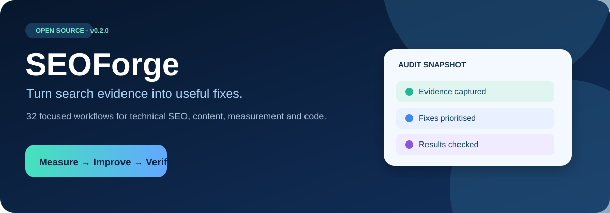
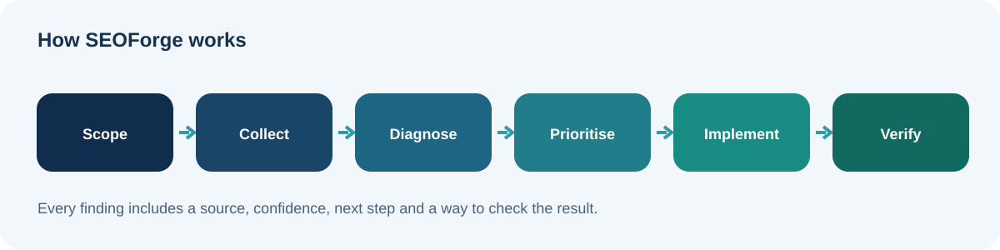

<div align="center">



# SEOForge

**Turn search evidence into useful fixes.**

[Quick start](#quick-start) · [Skills](#skill-catalog) · [How it works](#how-it-works) · [DevFlowForge](#devflowforge)

</div>

SEOForge is an open-source collection of **32 independently written skills** for SEO analysis, planning and implementation in compatible AI assistants. It covers crawl and indexing issues, content, Search Console interpretation, analytics, local and e-commerce SEO, migrations, AI search, and verifiable source-code fixes. It is created by **Vishaal Zala**.

**Version 0.2.0 · 31 specialist workflows + 1 router · MIT License**

## See the workflow


*The animation illustrates the workflow; it is not a recording of a live audit.*



A useful audit names the pages examined, shows its sources, distinguishes confirmed problems from hypotheses and gives a clear verification step for each change.

## Quick start

1. Open your site or repository in an assistant that can read skills, or provide a URL, exported crawl, HTML or analytics report.
2. Ask a concrete question. The `seo` router identifies a specialist skill; a specific specialist can also be selected directly where the client supports it.
3. Review the evidence and proposed fixes. Code changes need project access and appropriate tools.

**Try these requests:**

- “Audit my website. Tell me which pages you checked and give me the five highest-impact fixes.”
- “Analyse this Search Console export and find pages losing clicks. Check seasonal effects.”
- “Compare these queries and landing pages for cannibalisation and internal link gaps.”
- “Inspect the connected repository, fix confirmed canonical and sitemap problems, and run the build.”
- “Create a page brief and original draft using only the business facts I supply.”

## Skill catalog

| Skill | When to use |
|---|---|
| [`seo-ai-search`](skills/seo-ai-search/SKILL.md) | AI search visibility, answer engines or AI crawler access |
| [`seo-analytics-tracking`](skills/seo-analytics-tracking/SKILL.md) | auditing GA4 or other website analytics setup and organic search measurement |
| [`seo-audit`](skills/seo-audit/SKILL.md) | full website audits, prioritised SEO findings, or an overall SEO action plan |
| [`seo-bing`](skills/seo-bing/SKILL.md) | Bing Webmaster Tools exports, Bing indexing or IndexNow planning |
| [`seo-competitors`](skills/seo-competitors/SKILL.md) | competitor SEO comparisons or backlink profile analysis |
| [`seo-content`](skills/seo-content/SKILL.md) | content quality, expertise, trust, duplication or content refresh reviews |
| [`seo-content-plan`](skills/seo-content-plan/SKILL.md) | content briefs, editorial calendars, comparison pages or programmatic SEO plans |
| [`seo-content-writing`](skills/seo-content-writing/SKILL.md) | Use to draft complete SEO pages or refresh existing page copy |
| [`seo-conversion-tracking`](skills/seo-conversion-tracking/SKILL.md) | Use to implement or diagnose form, booking, signup or purchase measurement tied to organic search |
| [`seo-ecommerce`](skills/seo-ecommerce/SKILL.md) | product, category, variant or faceted-navigation SEO |
| [`seo-experiments`](skills/seo-experiments/SKILL.md) | Use to design and evaluate controlled SEO changes and template-wide tests |
| [`seo-foundation`](skills/seo-foundation/SKILL.md) | Use to establish reusable business, audience and SEO context for a project |
| [`seo-github`](skills/seo-github/SKILL.md) | implementing SEO fixes in a source repository or reviewing an SEO pull request |
| [`seo-international`](skills/seo-international/SKILL.md) | hreflang, language variants or regional search targeting |
| [`seo-keywords`](skills/seo-keywords/SKILL.md) | keyword ideas, search intent, topic clusters or keyword cannibalisation |
| [`seo-local`](skills/seo-local/SKILL.md) | local search, service-area pages, business profiles or citation consistency |
| [`seo-log-analysis`](skills/seo-log-analysis/SKILL.md) | search or AI crawler behaviour in Apache, Nginx or CDN access logs |
| [`seo-media`](skills/seo-media/SKILL.md) | image optimisation, alt text or video discovery |
| [`seo-migration`](skills/seo-migration/SKILL.md) | SEO migrations, URL redirect maps or before-and-after regression checks |
| [`seo-news-discover`](skills/seo-news-discover/SKILL.md) | news, publishing, Google Discover or fast-changing editorial sites |
| [`seo-on-page`](skills/seo-on-page/SKILL.md) | titles, descriptions, headings, URL structure or internal linking |
| [`seo-page`](skills/seo-page/SKILL.md) | a focused SEO review of one page |
| [`seo-performance`](skills/seo-performance/SKILL.md) | page speed, Lighthouse, PageSpeed or Core Web Vitals analysis |
| [`seo-reporting`](skills/seo-reporting/SKILL.md) | client SEO reports, audit exports or actionable SEO roadmaps |
| [`seo-schema`](skills/seo-schema/SKILL.md) | Schema.org JSON-LD inspection, validation or generation |
| [`seo-search-console`](skills/seo-search-console/SKILL.md) | Search Console exports or authorised property data, indexing, URL Inspection, CTR and query opportunities |
| [`seo-serp-analysis`](skills/seo-serp-analysis/SKILL.md) | current search results, search intent, SERP features and competing page formats |
| [`seo-site-architecture`](skills/seo-site-architecture/SKILL.md) | Use when planning site hierarchy, navigation, URL taxonomy or topic hubs before launch or a restructure |
| [`seo-sitemaps`](skills/seo-sitemaps/SKILL.md) | XML sitemaps or robots.txt review and generation |
| [`seo-technical`](skills/seo-technical/SKILL.md) | crawlability, indexing, redirects, canonicals or JavaScript SEO problems |
| [`seo-traffic-diagnosis`](skills/seo-traffic-diagnosis/SKILL.md) | unexplained SEO traffic drops, ranking declines or algorithm-update concerns |

The [`seo` router](skills/seo/SKILL.md) selects a workflow when the request is broad. Skills include limits on access and evidence, plus a common output format. Browse the [report template](assets/report-template.md) and [finding schema](assets/finding.schema.json).

## How it works

| Stage | Output |
|---|---|
| Scope | Business goal, pages, time range, permissions and tools |
| Collect | URL or file evidence and the source/date of each check |
| Diagnose | Confirmed findings, hypotheses, passed checks and unavailable checks |
| Prioritise | Actions ordered by impact, effort and dependencies |
| Implement | Focused changes when source access and authorisation exist |
| Verify | Tests, comparison data and remaining runtime checks |

**Example finding:** “The product page `/products/example` declares a canonical to a different product. Observed in the supplied HTML on 30 October 2026. Review the template’s canonical URL selection; verify the rendered page and target URL after changing it.” This is a fictional example, not an audit result.

## Installation

### ChatGPT

Where your account supports custom plugin archive import, build the skills-only package with `python scripts/package.py` and import the generated `dist/seoforge-0.2.0-plugin.zip`. The GitHub repository itself does not automatically install or update a ChatGPT plugin. Connect Search Console, analytics, GitHub or crawling tools separately if the workflow needs them.

### Other skills-aware assistants

```bash
git clone https://github.com/vishaalzala/SEOForge.git
cd SEOForge
python -m pip install -r requirements-dev.txt
python scripts/validate_package.py
```

Supply the relevant `skills/<name>/SKILL.md` to an assistant using its documented skills loader. Discovery and invocation vary by client.

### Offline HTML inventory

```bash
python scripts/inspect_html.py path/to/page.html
```

This utility inventories titles, headings, metadata, canonical links, images, links and JSON-LD syntax in a local HTML file. It does not fetch URLs, render JavaScript or validate search feature eligibility.

## Data and integrations

SEOForge is a skills-only package. Live Search Console, GA4, Bing, keyword and backlink data require an authorised connection or a supplied export; browser rendering and GitHub writes need corresponding tools. No API keys, crawler service, ranking database or scheduler are bundled. A request for live metrics with no source is answered with a data gap and useful next steps.

The skills do not promise rankings, traffic, rich results or AI citations. They verify current search rules against official sources and label exploratory AI search practices separately.

## DevFlowForge

SEOForge focuses on search visibility. [**DevFlowForge**](https://github.com/vishaalzala/DevFlowForge) is a companion collection of engineering and design skills covering product research, UX/UI, architecture, implementation, testing, security, performance and delivery. Use both when an SEO finding needs a careful website change. Each project remains independently installable.

## Quality and contribution

```bash
python scripts/validate_package.py
python -m unittest discover -s tests
python scripts/package.py
```

The automated checks cover the manifest, skill structure, archive and offline HTML helper. [Evaluation scenarios](docs/EVALUATION.md) cover expected agent behaviour; they are scenarios to run, not claims of completed live audits. CI produces a skills-only archive. See the [v0.2 implementation plan](docs/ROADMAP.md).

## Inspiration, author and licence

SEOForge takes inspiration from the modular approach in [AgriciDaniel/claude-seo](https://github.com/AgriciDaniel/claude-seo) and a review of other public SEO skill packages. Its skills and artwork were written for this project; the other projects' code, prompts and visual assets are not bundled. Inspiration does not imply affiliation or endorsement.

**Vishaal Zala** · [MIT License](LICENSE) · Copyright © 2026 Vishaal Zala.
